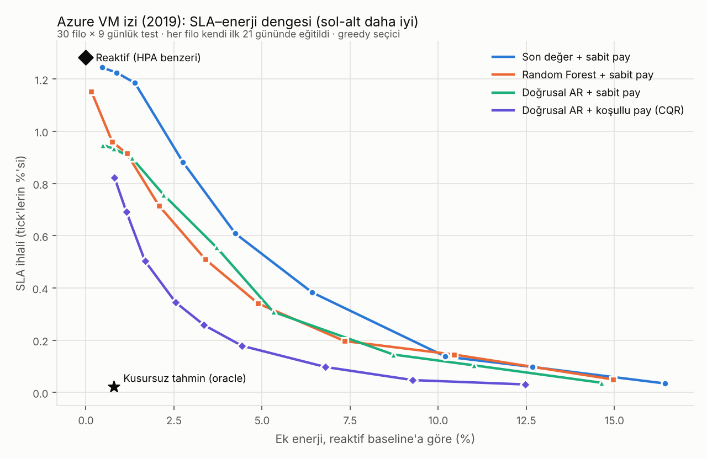

# Predictive Workload Autoscaler

ML-powered, workload-aware datacenter autoscaling simulator using Random Forest, LSTM, and GraphSAGE forecasts with optional LLM-based workload classification.

## Overview

This project simulates heterogeneous server fleets and predicts near-future CPU behavior to make proactive autoscaling decisions.  
The autoscaler optimizes for fewer active servers, lower power/cost, and safe utilization limits.

## Key Features

- Multi-model forecasting: `RandomForest`, `LSTM`, `GraphSAGE`
- Workload-aware autoscaling with server affinity rules
- Optional LLM advisor for dominant workload classification
- Docker-first workflow for reproducible training/evaluation
- JSON/CSV outputs for experiment tracking

## Policy Evaluation (v2) — ground-truth demand harness

> The original autoscaler evaluation in `train.py` was **circular**: each active server's CPU was set to the model's own prediction, so there was no ground-truth demand and load never moved to other servers when one was put to sleep. Its operational KPIs are therefore **not valid** and it has been disabled. All policy comparisons now use `evaluate_policies.py`.

**What the harness models**
- Fleet demand comes from the traffic generator and is identical for every policy (same seed means the same demand and the same failures).
- Demand is split across serving servers in proportion to their capacity.
- Utilisation above 85% counts as an SLA violation; above 100%, requests are dropped.
- A woken server needs 1 tick (5 min) to boot.
- Scale-in uses a 3-tick, HPA-style stabilisation window and make-before-break.

**What is compared**
- **Reactive (HPA-like) baseline:** scales on the demand observed now.
- **Naive persistence + safety margin:** uses the last observed value plus a margin.
- **Random Forest / LSTM forecasts + margin**
- **Oracle:** perfect knowledge of future demand; this is the upper bound.

Each policy runs with two server selectors: a greedy rps/W selector and the original combinatorial optimiser.

**Statistics:** 30 independent seeds × 7 days, with paired bootstrap 95% confidence intervals.

```bash
python evaluate_policies.py        # main comparison  -> logs/policy_comparison.json   (~4 min)
python pareto_margin.py            # margin sweep / SLA–energy Pareto -> logs/pareto_margin.{json,png} (~10 min, 2 cores)
python -m pytest tests -q          # 35 correctness tests (demand conservation, boot delay, no look-ahead, coverage, ...)
```

**Forecasting + safety-margin methods**

| Name | Point forecast | Safety margin |
|---|---|---|
| `naive` | last observed value | fixed q-quantile of validation residuals |
| `rf` | Random Forest | fixed q-quantile |
| `lin` | linear AR / ridge (coefficients learned from data) | fixed q-quantile |
| **`linq`** | linear AR | **state-conditional margin**: per-τ gradient-boosted quantile regression on the residual (inputs: level, recent changes, AR "surprise", hour, workload), calibrated with conformalized quantile regression (CQR) |

**Key results (synthetic workload, greedy selector, 30 seeds × 7 days, paired 95% CIs vs `rf`)**

| | `rf` | `lin` | **`linq`** | `linq` − `rf` |
|---|---|---|---|---|
| SLA violations at +3% energy | 1.25% | 1.16% | **0.86%** | −0.39 [−0.46, −0.33] |
| SLA violations at +5% energy | 1.03% | 1.01% | **0.48%** | −0.55 [−0.61, −0.49] |
| Extra energy to reach 1% SLA | +5.2% | +5.2% | **+2.6%** | −2.6 pts [−3.2, −2.0] |
| Extra energy to reach 0.5% SLA | +10.4% | +11.1% | **+4.9%** | −5.6 pts [−6.1, −5.1] |

**Reading the table**
- **Conditional margin vs. the best fixed-margin method:** `linq` halves the extra energy needed for a 1% SLA target compared with the best fixed-margin method.
- **Where the gain comes from:** almost entirely from the conditional margin. The linear forecaster alone (`lin`) is on par with RF.
- **Untouched seeds:** results are the same on seeds that were never used during development (2005–2030).
- **No look-ahead:** randomly corrupting the future never changes a decision (tested).

**Baselines for context**
- Reactive HPA-like scaling: 2.41% SLA violations.
- Oracle (perfect forecast): 0.02% SLA violations at +0.5% energy.
- LSTM does not beat naive persistence.
- The original combinatorial optimiser uses 15–21% more energy than the greedy selector.


### Real-trace validation: Azure Public Dataset V2 (2019 VM trace)

**Data and protocol**
- **Trace size:** 30 days, 2.7 M VMs, 1.94 B five-minute CPU readings. All rows were processed; the row count matches the dataset documentation exactly.
- **Demand:** aggregated per subscription as used cores = Σ avg CPU × cores.
- **Fleets:** 30 disjoint fleets, each made of 20 random subscriptions.
- **Train/test split:** each fleet is trained only on its own days 0–20 and tested on days 21–29, with the same hyperparameters as the synthetic study.

```bash
cd data_prep && ./download_and_aggregate.sh   # see header: streams ~156 GB, keeps a 168 MB matrix
python azure_eval.py                         # -> logs/azure_pareto.{json,png}
```

**Results** (paired 95% CIs over fleets; mean SLA over the common +0–10% energy range)

| Comparison | Δ SLA (pts) | 95% CI | Fleets won |
|---|---|---|---|
| `linq` vs `naive` | −0.17 (0.59 → 0.42) | [−0.35, −0.03] | 17/27 (6 ties) |
| `linq` vs `lin` (value of the conditional margin) | −0.08 | [−0.16, −0.02] | 16/27 |
| `linq` vs `rf` | −0.28 (0.70 → 0.42) | [−0.81, +0.05] | 14/27 (6 ties) |

**Honest summary**
- **Consistent finding:** on real Azure workloads, the conditional (CQR) safety margin reduces SLA violations significantly compared with fixed-margin methods.
- **Limits of the finding:** most real fleets were smooth and left little room for improvement; only 8 of 30 had ≥0.5% violations under reactive scaling. Against Random Forest the advantage is directional (−40% on average) but not statistically conclusive.



*Caveats:*
- The traffic generator re-draws its pattern every tick, so the harness holds regimes for about 1 hour and adds EMA inertia.
- Part of the conditional margin's advantage comes from regularities in the synthetic generator: switch probability varies by hour, and upward jump size depends on load level.
- Real fleets in the Azure trace are concentrated: the largest subscription contributes a median 51% of a fleet's demand.

## Project Structure

```text
core/       Autoscaler engine, traffic generation, metrics, workload advisor
models/     ML model implementations and serialized model artifacts
data/       Generated metric datasets (snapshot + wide format)
logs/       Training and evaluation result JSON files
tests/      Correctness tests for the evaluation harness
train.py    Model training pipeline (per-server RF / LSTM / GraphSAGE)
evaluate_policies.py  Ground-truth policy comparison harness (v2)
azure_eval.py         Real-trace validation on the Azure 2019 VM trace
data_prep/            Streaming download + aggregation of the Azure trace
pareto_margin.py      Safety-margin sweep and SLA–energy Pareto analysis
```

## Quick Start (Docker)

```bash
docker compose build
docker compose run --rm train
docker compose run --rm eval
```

Optional LLM-assisted evaluation:

```bash
export OPENAI_API_KEY="your_key_here"
docker compose run --rm eval_llm
```

## Quick Start (Local Python)

```bash
python3 -m venv .venv
source .venv/bin/activate
pip install -r requirements.txt
python train.py
```

Policy evaluation (v2):

```bash
python evaluate_policies.py
```

> `python train.py --eval-only` no longer runs the old (circular) autoscaler test; it points to `evaluate_policies.py`.

## Outputs

- `data/metrics_snapshot.csv`
- `data/metrics_wide.csv`
- `models/*.pkl`
- `logs/training_results.json`
- `logs/policy_comparison.json` — policy comparison (v2)
- `logs/pareto_margin.json`, `logs/pareto_margin.png` — margin sweep / Pareto
