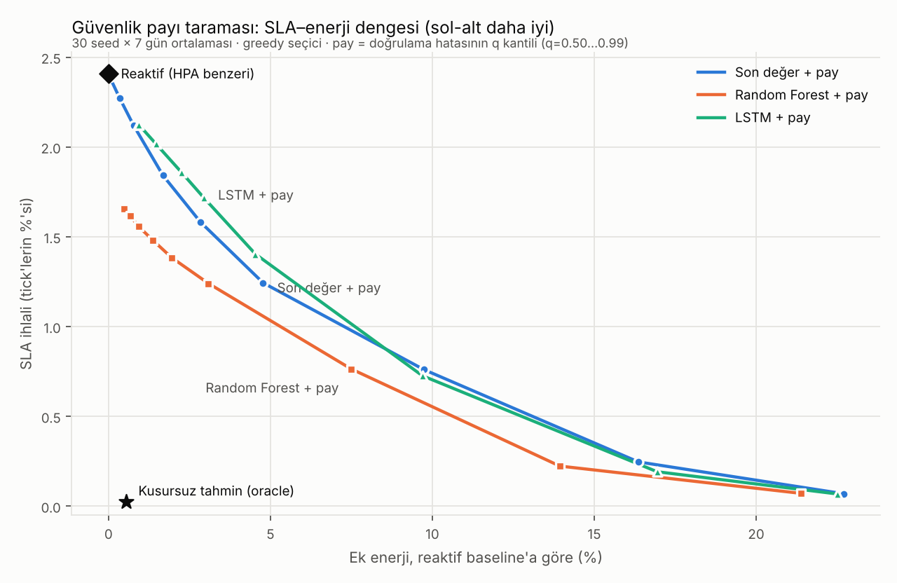

# Predictive Workload Autoscaler

ML-powered, workload-aware datacenter autoscaling simulator using Random Forest, LSTM, and GraphSAGE forecasts with optional LLM-based workload classification.

## Overview

This project simulates heterogeneous server fleets and predicts near-future CPU behavior to make proactive autoscaling decisions.  
The autoscaler optimizes for fewer active servers, lower power/cost, and safe utilization limits.

## Key Features

- Multi-model forecasting: `RandomForest`, `LSTM`, `GraphSAGE`
- Workload-aware autoscaling with server affinity rules
- Optional LLM advisor for dominant workload classification
- Docker-first workflow for reproducible training/evaluation
- JSON/CSV outputs for experiment tracking

## Policy Evaluation (v2) — ground-truth demand harness

> The original autoscaler evaluation in `train.py` was **circular**: each active server's CPU was set to the model's own prediction, so there was no ground-truth demand and load never moved to other servers when one was put to sleep. Its operational KPIs are therefore **not valid** and it has been disabled. All policy comparisons now use `evaluate_policies.py`.

**What the harness models**
- Fleet demand comes from the traffic generator and is identical for every policy (same seed means the same demand and the same failures).
- Demand is split across serving servers in proportion to their capacity.
- Utilisation above 85% counts as an SLA violation; above 100%, requests are dropped.
- A woken server needs 1 tick (5 min) to boot.
- Scale-in uses a 3-tick, HPA-style stabilisation window and make-before-break.

**What is compared**
- **Reactive (HPA-like) baseline:** scales on the demand observed now.
- **Naive persistence + safety margin:** uses the last observed value plus a margin.
- **Random Forest / LSTM forecasts + margin**
- **Oracle:** perfect knowledge of future demand; this is the upper bound.

Each policy runs with two server selectors: a greedy rps/W selector and the original combinatorial optimiser.

**Statistics:** 30 independent seeds × 7 days, with paired bootstrap 95% confidence intervals.

```bash
python evaluate_policies.py        # main comparison  -> logs/policy_comparison.json   (~4 min)
python pareto_margin.py            # margin sweep / SLA–energy Pareto -> logs/pareto_margin.{json,png} (~7 min)
python -m pytest tests -q          # 24 correctness tests (demand conservation, boot delay, no look-ahead, ...)
```

**Key results (synthetic workload, greedy selector, 30 seeds)**

| At +1% energy vs. reactive baseline | SLA violations (% of ticks) |
|---|---|
| Reactive (HPA-like) | 2.41 |
| Naive persistence + margin | 2.05 |
| **Random Forest + margin** | **1.54** (−36% vs reactive, −25% vs naive; paired 95% CI excludes 0) |
| Oracle (perfect forecast, +0.5% energy) | 0.02 |

- To reach 1% SLA violations, Random Forest needs about 1.9 percentage points less extra energy than naive.
- LSTM does not beat naive persistence at equal energy.
- The original combinatorial optimiser uses 15–21% more energy than the greedy selector and causes about 5× more server wake-ups.
- Most of the gap to the oracle is still open; closing it is ongoing work.



*Caveat:* the traffic generator re-draws its pattern every tick, so the harness holds regimes for about 1 hour and adds EMA inertia. Validation on a public cloud trace is planned.

## Project Structure

```text
core/       Autoscaler engine, traffic generation, metrics, workload advisor
models/     ML model implementations and serialized model artifacts
data/       Generated metric datasets (snapshot + wide format)
logs/       Training and evaluation result JSON files
tests/      Correctness tests for the evaluation harness
train.py    Model training pipeline (per-server RF / LSTM / GraphSAGE)
evaluate_policies.py  Ground-truth policy comparison harness (v2)
pareto_margin.py      Safety-margin sweep and SLA–energy Pareto analysis
```

## Quick Start (Docker)

```bash
docker compose build
docker compose run --rm train
docker compose run --rm eval
```

Optional LLM-assisted evaluation:

```bash
export OPENAI_API_KEY="your_key_here"
docker compose run --rm eval_llm
```

## Quick Start (Local Python)

```bash
python3 -m venv .venv
source .venv/bin/activate
pip install -r requirements.txt
python train.py
```

Policy evaluation (v2):

```bash
python evaluate_policies.py
```

> `python train.py --eval-only` no longer runs the old (circular) autoscaler test; it points to `evaluate_policies.py`.

## Outputs

- `data/metrics_snapshot.csv`
- `data/metrics_wide.csv`
- `models/*.pkl`
- `logs/training_results.json`
- `logs/policy_comparison.json` — policy comparison (v2)
- `logs/pareto_margin.json`, `logs/pareto_margin.png` — margin sweep / Pareto
